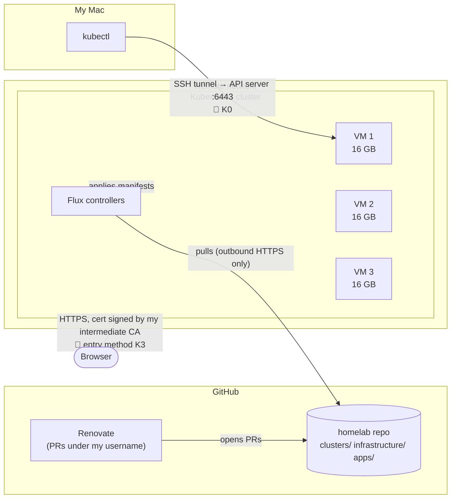
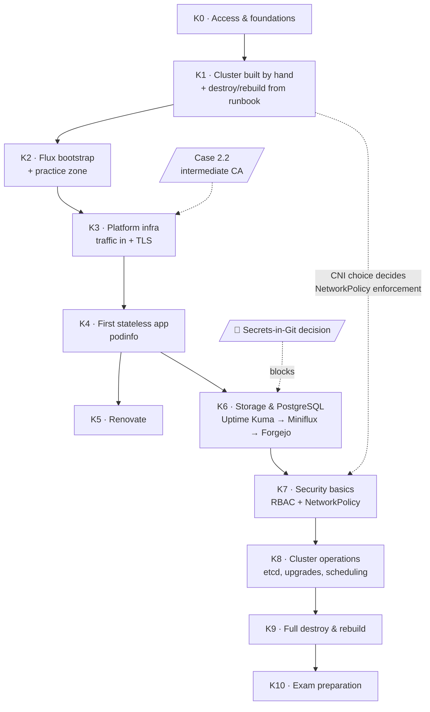

# Kubernetes lab plan: 3 remote VMs → CKA

**Context:** 3 VMs × 16 GB RAM on a remote network, reached over SSH. Manifests live in Git and are synced by Flux. Renovate opens PRs under my username.

**End goal:** pass the CKA.

**Rule for the whole plan:** every phase includes **break drills**. Troubleshooting is 30% of the exam, so it is practiced throughout, not saved for the end.

🔸 marks a decision that is still open. Each one gets a short ADR when it is made.

---

## Target architecture

Flux **pulls** from GitHub, so the cluster only needs outbound HTTPS. Nothing has to reach into the remote network except my SSH access.

---

## Roadmap

Solid arrows show the phase order. Dotted arrows show dependencies that are easy to forget.

---

## Phases

### K0: Access and foundations
- **Goal:** reach the nodes and know their network.
- 🔸 How I reach the API server (6443), and which address my kubeconfig points to. This decides the API server certificate SANs.
- **Done when:** I can SSH to all 3 nodes, and their IPs, OS and outbound internet access are written down.

### K1: Cluster built by hand
- **Goal:** a bare cluster, built the way the exam expects.
- 🔸 Distribution: kubeadm, k3s, or both. The CKA uses kubeadm.
- 🔸 Topology: 1 control plane + 2 workers, or 3 control planes.
- 🔸 CNI. ⚠️ It must enforce NetworkPolicy, otherwise K7 can't be done.
- **Deliverable:** a written runbook, since Ansible comes later.
- **Done when:** 3 nodes are Ready, then the cluster is **destroyed and rebuilt from the runbook alone**.
- **CKA:** Cluster Architecture, Installation & Configuration.

### K2: Flux bootstrap and a practice zone
- **Goal:** the cluster syncs itself from Git, and there is still a place where Flux does not revert manual changes.
- 🔸 Repo structure, and how Flux authenticates to the repo.
- 🔸 Which namespaces Flux manages and which are left for manual practice.
- **Done when:** a Git change shows up in the cluster without `kubectl apply`, and a manual change in the practice zone survives.

### K3: Platform infrastructure, getting traffic in
- **Goal:** HTTPS from the outside, with a certificate signed by my intermediate CA (case 2.2).
- 🔸 How traffic gets in on a network I don't control: NodePort, hostPort or LoadBalancer.
- 🔸 Ingress or Gateway API (Gateway API is in the CKA).
- 🔸 How cert-manager gets the CA key, and what that exposes.
- **Test app:** traefik/whoami.
- **Done when:** whoami answers over HTTPS and my Mac trusts the certificate.
- **CKA:** Services & Networking.

### K4: First stateless app
- **Goal:** podinfo deployed only through Git.
- **What I practice:** probes, requests/limits, rolling updates, rollback.
- **Done when:** podinfo is deleted by hand and Flux recreates it, and a bad version is rolled back.
- **CKA:** Workloads & Scheduling.

### K5: Renovate
- **Goal:** new versions arrive as PRs.
- 🔸 Where Renovate runs, the token's scope, and auto-merge or review every PR.
- **Done when:** a Renovate PR on podinfo is merged and Flux rolls it out.

### K6: Storage and PostgreSQL
- **Goal:** state that survives pod restarts.
- 🔸 Storage provisioner (local first, see FORMATION section 9).
- 🔸 PostgreSQL: one per app, one shared, or an operator.
- ⚠️ **Blocked by** the secrets-in-Git decision, because Miniflux needs a database password.
- **Order:** Uptime Kuma (SQLite) → Miniflux (PostgreSQL) → Forgejo.
- **Done when:** a pod is deleted and its data is still there.
- **CKA:** Storage.

### K7: Security basics
- **Goal:** least privilege inside the cluster.
- **What I practice:** RBAC (a ServiceAccount with minimal rights), NetworkPolicy (only Miniflux can reach its PostgreSQL).
- **Done when:** an unauthorized pod's connection to PostgreSQL is refused.

### K8: Cluster operations
- **Goal:** the operational tasks the exam focuses on.
- **What I practice:** etcd backup and restore, a kubeadm minor upgrade, drain/cordon, taints and affinity, static pods.
- **Done when:** etcd is restored from a backup and the apps come back, and the cluster has been upgraded one minor version.
- **CKA:** Cluster Architecture, Troubleshooting.

### K9: Full destroy and rebuild
- **Goal:** prove the whole setup works (Règle 2).
- **Done when:** VMs reinstalled, cluster rebuilt from the runbook, Flux bootstrapped, apps back. Everything Git can't restore (data) is written down as a known gap.

### K10: Exam preparation
- Timed drills: imperative `kubectl`, generating YAML with `--dry-run=client -o yaml`, finding things fast in the kubernetes.io docs.
- killer.sh simulator, twice.
- Book the exam.

---

## Open decisions, in the order they block

| # | Decision | Blocks | Status |
|---|---|---|---|
| 1 | Access to 6443 | K0 | 🔸 Open |
| 2 | Distribution, topology, CNI | K1 | 🔸 Open |
| 3 | Repo structure and practice zone | K2 | 🔸 Open |
| 4 | Traffic entry, Ingress vs Gateway API | K3 | 🔸 Open |
| 5 | Secrets in Git | K6 | 🔸 Open |
| 6 | Storage and PostgreSQL model | K6 | 🔸 Open |
| 7 | Renovate location, token scope, merge policy | K5 | 🔸 Open |

## Later, not CKA

Kyverno, Cilium in depth, supply chain (signing, SBOM), Velero, Flagger, writing an operator in Go. Each needs a real trigger first.
